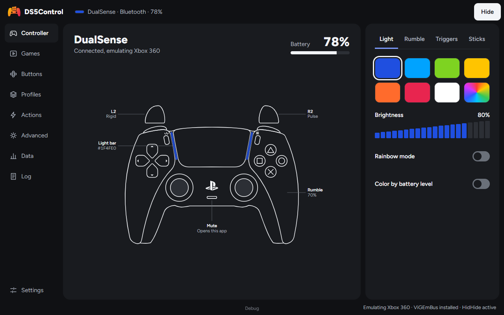
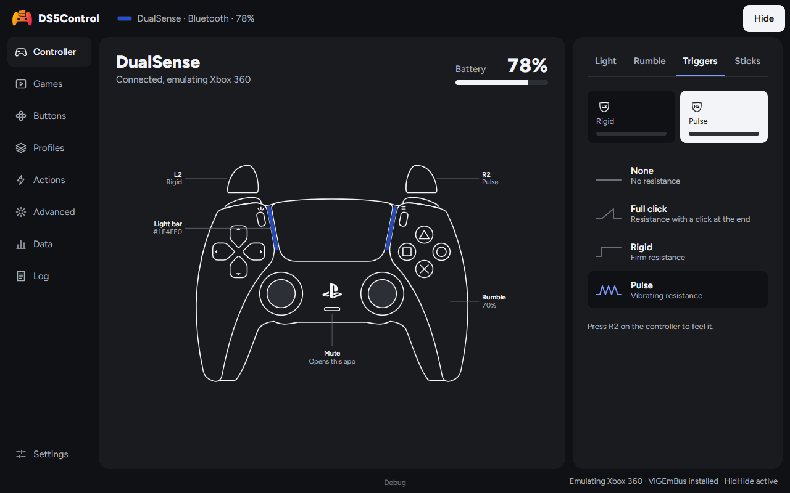
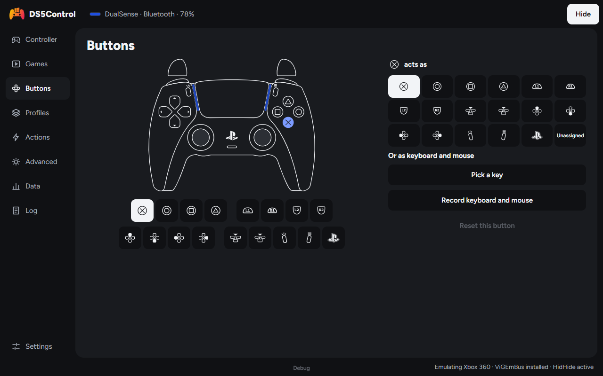
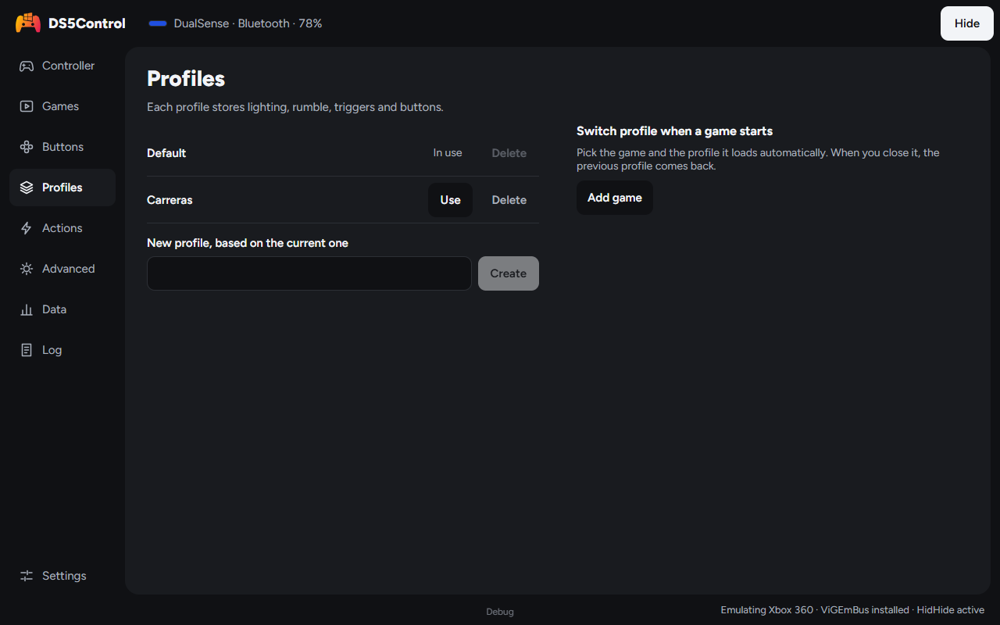
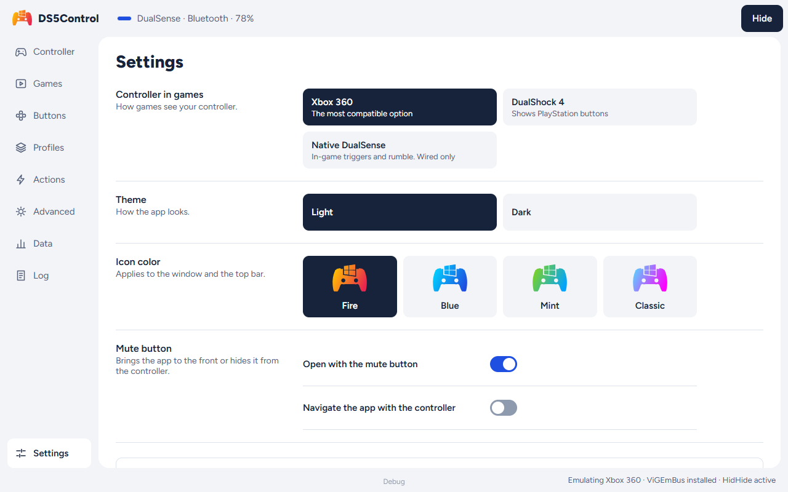
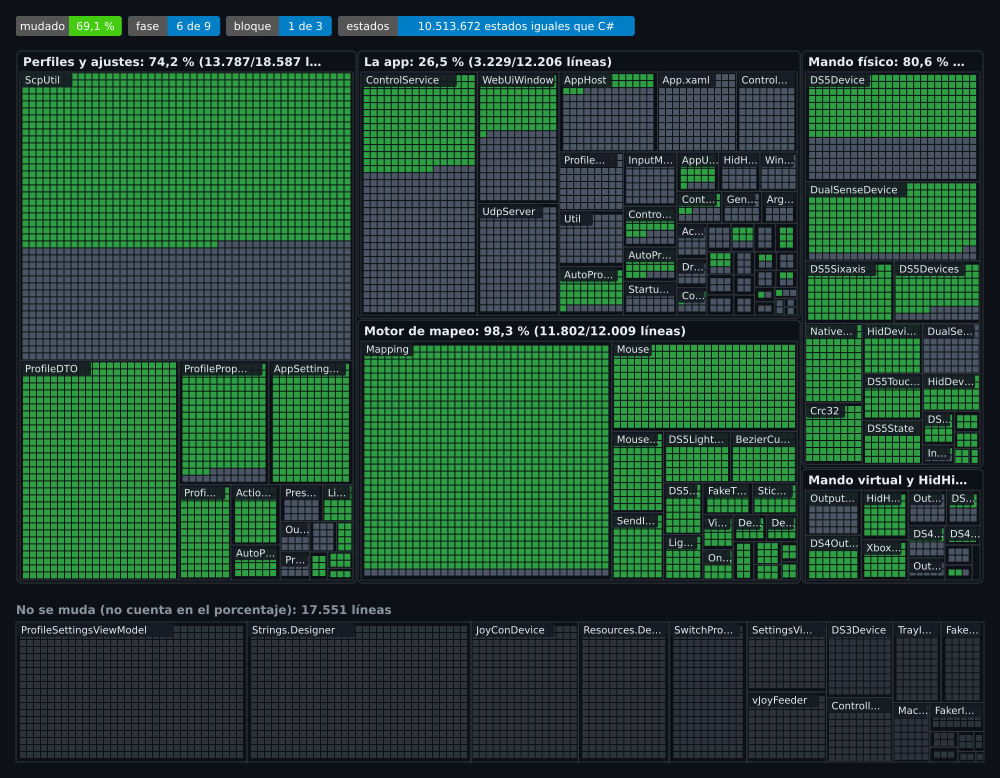

<p align="center">
  
</p>

<h1 align="center">DS5Control</h1>

<p align="center">
  <strong>Your PlayStation controller on Windows, set up from the controller itself.</strong><br>
  Light bar, rumble and adaptive triggers for the DualSense in a few seconds, then back to your game.
</p>

<p align="center">
  <a href="https://github.com/anxo0/DS5Control/releases/latest"></a>
  <a href="LICENSE.txt"></a>
  
</p>

<p align="center">
  <a href="https://github.com/anxo0/DS5Control/releases/latest"><strong>Download for Windows</strong></a>
  &nbsp;·&nbsp;
  <a href="#install">How to install</a>
  &nbsp;·&nbsp;
  <a href="#features">Features</a>
</p>

<p align="center">
  <picture>
    <source media="(prefers-color-scheme: light)" srcset="assets/readme/controller-light.png">
    
  </picture>
</p>

DS5Control is a fork of [DS4Windows](https://github.com/schmaldeo/DS4Windows) with a new interface built around the DualSense. Press the mute button on the controller and the app comes to the front. Move through it with the D-pad, change what you need, press mute again and keep playing.

## Why DS5Control

- **Opens from the controller.** The mute button brings the window up or hides it. Turn on controller navigation in Settings and every screen works with the D-pad and Cross; the mouse keeps working.
- **The everyday settings are on the first screen.** Battery, light bar colour, rumble strength and trigger effects, with changes you feel on the controller as you make them.
- **Profiles follow your games.** Pick a game and the profile it loads: it switches when the game starts and goes back when you close it.
- **Light on your PC.** Written in Rust, it uses about 3 MB of memory while it waits in the tray, and its download is a fifth of the old C# version.

## Features

| | |
|---|---|
| **Controller emulation** | Xbox 360 or DualShock 4, so games recognise the controller. Native mode for games that already support the DualSense (wired). |
| **Light bar** | Preset and custom colours, brightness, rainbow mode and colour by battery level. |
| **Rumble and adaptive triggers** | Rumble strength, and trigger effects per side: off, full click, rigid and pulse. |
| **Live controller view** | Buttons, sticks and triggers react as you press them, with stick drift checks. |
| **Automatic profiles** | Each profile stores lighting, rumble, triggers and buttons, and can load on its own when a game starts. |
| **Remapping, macros and actions** | Any button can act as another button, a key, a mouse action or a recorded macro, or launch programs and switch profiles. |
| **Gyro and touchpad** | As mouse or stick, or sent over DSU to emulators such as Cemu, Ryujinx or Dolphin. |
| **Controller data** | Battery voltage, usage time, button presses and factory information. |
| **Look and language** | Light and dark themes, four icon colours, and English, Spanish and Portuguese, taken from Windows or chosen in Settings. |

<table>
  <tr>
    <td width="50%"></td>
    <td width="50%"></td>
  </tr>
  <tr>
    <td align="center"><sub>Adaptive triggers, one effect per side</sub></td>
    <td align="center"><sub>Remap any button to another button, a key or a macro</sub></td>
  </tr>
  <tr>
    <td width="50%"></td>
    <td width="50%"></td>
  </tr>
  <tr>
    <td align="center"><sub>Profiles that switch when a game starts</sub></td>
    <td align="center"><sub>Settings, in the light theme</sub></td>
  </tr>
</table>

## Install

Get the [latest release](https://github.com/anxo0/DS5Control/releases/latest) in one of two forms:

- **Installer:** run `DS5Control-x.y.z-installer.exe` and open DS5Control from the Start menu. No administrator rights needed.
- **Portable:** unzip `DS5Control-x.y.z-portable-win-x64.zip` anywhere and run `DS5Control.exe`.

Both update themselves when opened.

> [!NOTE]
> The program is not signed, so Windows SmartScreen may stop it the first time. Click **More info** and then **Run anyway**.

The last version built in C# is kept as [DS5Control 0.2.9 (deprecated)](https://github.com/anxo0/DS5Control/releases/tag/v0.2.9-deprecated). It no longer gets updates.

## Requirements

- Windows 10 or 11, 64-bit.
- ViGEmBus, to emulate controllers. It is bundled, and the installer adds it if missing.
- WebView2 Runtime, already part of Windows 11.
- Recommended: [HidHide](https://github.com/nefarius/HidHide), so games do not see the controller twice. It is bundled too: the app offers it the first time and from Settings.

> [!WARNING]
> Some anti-cheat systems may react to emulated controllers. Be careful with online games.

## Built with Rust

Measured on the same PC, with the same settings, against the last C# version (0.2.8):

| | C# 0.2.8 | Rust 0.3.0 |
|---|---|---|
| Memory, waiting in the tray | 55 MB | 3 MB |
| Memory, window open | 225 MB | 156 MB |
| CPU, idle | under 0.1 % | under 0.1 % |
| Portable download | 73 MB | 13 MB |

DS5Control moved from C# to Rust piece by piece, without ever stopping working, and since 0.3.0 it runs entirely on Rust. Each square is a piece of the C# code, sized by its lines: green means its Rust version is done and gives exactly the same result. The grey strip at the bottom is what was left behind on purpose, such as the old WPF interface.

<p align="center">
  
</p>

## Building

You need Node.js and a Rust toolchain.

```bash
cd ui
npm ci
npm run build
cd ../rust
cargo build --release -p ds5-app
```

The program ends up in `rust/target/release/DS5Control.exe`. The tests compare the Rust engine with recordings of the C# one: `cargo test --workspace`.

To work on the interface alone, `npm run dev` inside `ui` starts it in the browser with a simulated controller.

## Credits

- Based on DS4Windows, by Jays2Kings, Ryochan7, schmaldeo and their contributors.
- Controller drawings: [dualsense-tester](https://github.com/daidr/dualsense-tester), by daidr (MIT).
- Button icons: [PS5 Button Icons and Controls](https://zacksly.itch.io/ps5-button-icons-and-controls), by Zacksly (CC BY 3.0).

See [ui/THIRD_PARTY.md](ui/THIRD_PARTY.md) and [contributors.txt](contributors.txt).

## License

GNU General Public License v3.0. See [LICENSE.txt](LICENSE.txt).

Independent project, not affiliated with Sony, Microsoft or the DS4Windows authors. PlayStation, DualSense and DualShock are trademarks of Sony Interactive Entertainment. Windows and Xbox are trademarks of Microsoft.
